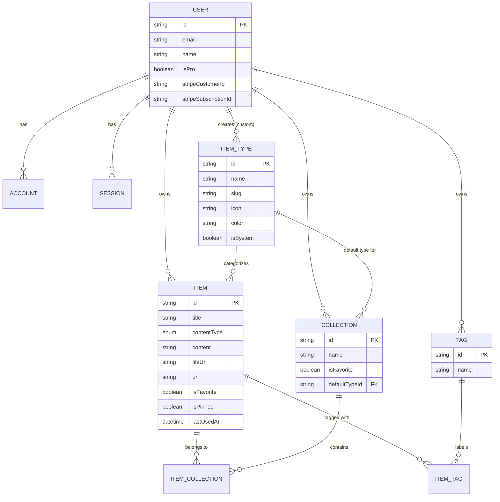
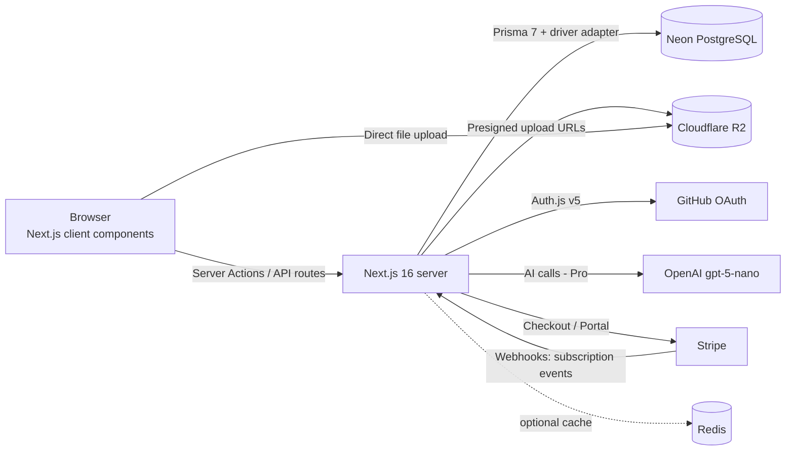
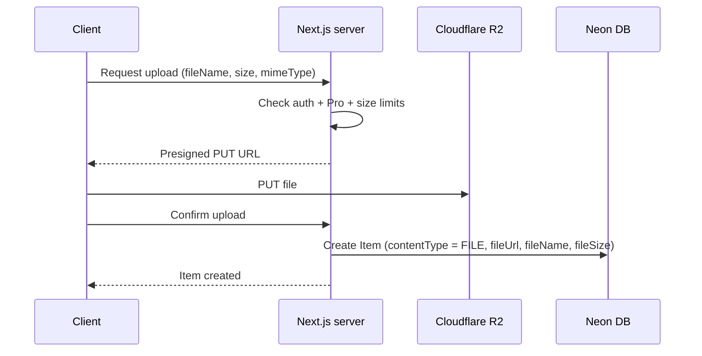
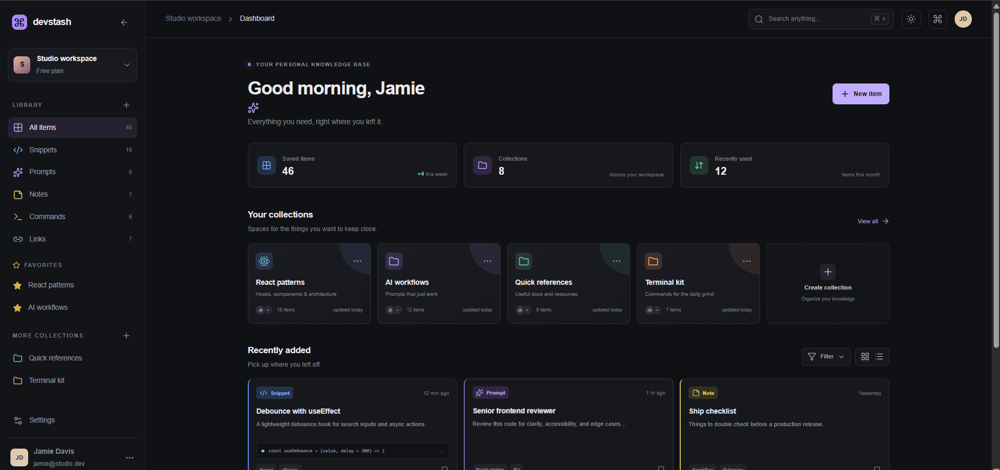
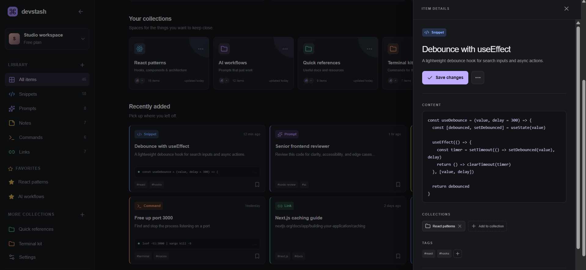

# DevStash — Project Overview

> **One fast, searchable, AI-enhanced hub for all your dev knowledge and resources.**

---

## Table of Contents

1. [Problem](#1-problem)
2. [Target Users](#2-target-users)
3. [Features](#3-features)
4. [Data Model](#4-data-model)
5. [Tech Stack](#5-tech-stack)
6. [Architecture](#6-architecture)
7. [Monetization](#7-monetization)
8. [UI / UX](#8-ui--ux)
9. [Routes](#9-routes)
10. [Open Questions & Recommendations](#10-open-questions--recommendations)
11. [Reference Links](#11-reference-links)

---

## 1. Problem

Developers keep their essentials scattered across many tools:

| What                 | Where it usually lives        |
| -------------------- | ----------------------------- |
| Code snippets        | VS Code, Notion               |
| AI prompts           | Chat histories                |
| Context files        | Buried inside projects        |
| Useful links         | Browser bookmarks             |
| Docs                 | Random folders                |
| Commands             | `.txt` files                  |
| Project templates    | GitHub Gists                  |
| Terminal commands    | Bash history                  |

This causes **context switching**, **lost knowledge**, and **inconsistent workflows**.

**DevStash** brings all of it into one place: fast to save, fast to find, and enhanced with AI.

---

## 2. Target Users

| Persona                        | Primary need                                             |
| ------------------------------ | -------------------------------------------------------- |
| **Everyday Developer**         | Quickly grab snippets, prompts, commands, and links      |
| **AI-first Developer**         | Save prompts, context files, workflows, system messages  |
| **Content Creator / Educator** | Store code blocks, explanations, course notes            |
| **Full-stack Builder**         | Collect patterns, boilerplates, API examples             |

---

## 3. Features

### A. Items & Item Types

Every item has a **type**. Users will eventually create custom types (Pro), but the app ships with these **system types**, which cannot be edited or deleted:

| Type      | Content kind | Icon (Lucide)  | Color                  | Plan      |
| --------- | ------------ | -------------- | ---------------------- | --------- |
| `snippet` | Text         | `Code`         | `#3b82f6` 🔵 Blue      | Free      |
| `prompt`  | Text         | `Sparkles`     | `#8b5cf6` 🟣 Purple    | Free      |
| `note`    | Text         | `StickyNote`   | `#fde047` 🟡 Yellow    | Free      |
| `command` | Text         | `Terminal`     | `#f97316` 🟠 Orange    | Free      |
| `link`    | URL          | `Link`         | `#10b981` 🟢 Emerald   | Free      |
| `file`    | File         | `File`         | `#6b7280` ⚪ Gray      | **Pro**   |
| `image`   | File         | `Image`        | `#ec4899` 🩷 Pink      | **Pro**   |

- Each type has its own list route, e.g. `/items/snippets`, `/items/prompts`.
- Items open and are created in a **quick-access drawer** (no full page navigation).

### B. Collections

- Users create collections that can hold items of **any type**.
- An item can belong to **multiple collections** (many-to-many).
  - e.g. a React snippet can live in both *React Patterns* and *Interview Prep*.

Examples:

| Collection       | Typical contents  |
| ---------------- | ----------------- |
| React Patterns   | snippets, notes   |
| Context Files    | files             |
| Python Snippets  | snippets          |

### C. Search

Search across:

- Content
- Titles
- Tags
- Types

> Free = basic search. Pro could later add full-text/fuzzy ranking (see [Open Questions](#10-open-questions--recommendations)).

### D. Authentication

- Email / password
- GitHub OAuth

### E. Other Features

- ⭐ Favorite collections and items
- 📌 Pin items to the top
- 🕒 Recently used items
- 📥 Import code from a file
- 📝 Markdown editor for text types
- 📤 File upload for `file` / `image` types
- 📦 Export data in multiple formats (JSON / ZIP — Pro)
- 🎨 Selectable color themes, each with a light and a dark mode (dark by default)
- ➕ Add/remove an item to/from multiple collections
- 🔎 See which collections an item belongs to

### F. AI Features (Pro only)

| Feature                 | Description                                         |
| ----------------------- | --------------------------------------------------- |
| Auto-tag suggestions    | Suggest tags based on item content                  |
| AI summaries            | Short summary of long notes, docs, or files         |
| Explain This Code       | Plain-language explanation of a snippet / command   |
| Prompt optimizer        | Rewrite and improve saved AI prompts                |

---

## 4. Data Model

> Rough model — not set in stone. Uses the Auth.js (NextAuth v5) Prisma adapter models plus DevStash-specific models.

### Entity Relationship Diagram



### Prisma Schema

> The source of truth is `prisma/schema.prisma`.

```prisma
// prisma/schema.prisma
// Prisma 7: generator uses "prisma-client" with an explicit output path;
// the connection URL lives in prisma.config.ts and a driver adapter
// (e.g. @prisma/adapter-neon or @prisma/adapter-pg) is passed to PrismaClient.

generator client {
  provider = "prisma-client"
  output   = "../src/generated/prisma"
}

datasource db {
  provider = "postgresql"
}

// ─────────────────────────────────────────────
// Enums
// ─────────────────────────────────────────────

enum ContentType {
  TEXT // snippet, prompt, note, command
  URL  // link
  FILE // file, image
}

// ─────────────────────────────────────────────
// Auth.js (NextAuth v5) models
// ─────────────────────────────────────────────

model User {
  id             String    @id @default(cuid())
  name           String?
  email          String    @unique
  emailVerified  DateTime?
  image          String?
  hashedPassword String? // for email/password sign-in

  // Billing
  isPro                Boolean @default(false)
  stripeCustomerId     String? @unique
  stripeSubscriptionId String? @unique

  accounts    Account[]
  sessions    Session[]
  items       Item[]
  itemTypes   ItemType[]
  collections Collection[]
  tags        Tag[]

  createdAt DateTime @default(now())
  updatedAt DateTime @updatedAt
}

model Account {
  id                String  @id @default(cuid())
  userId            String
  type              String
  provider          String
  providerAccountId String
  refresh_token     String? @db.Text
  access_token      String? @db.Text
  expires_at        Int?
  token_type        String?
  scope             String?
  id_token          String? @db.Text
  session_state     String?

  user User @relation(fields: [userId], references: [id], onDelete: Cascade)

  @@unique([provider, providerAccountId])
  @@index([userId])
}

model Session {
  id           String   @id @default(cuid())
  sessionToken String   @unique
  userId       String
  expires      DateTime

  user User @relation(fields: [userId], references: [id], onDelete: Cascade)

  @@index([userId])
}

model VerificationToken {
  identifier String
  token      String   @unique
  expires    DateTime

  @@unique([identifier, token])
}

// ─────────────────────────────────────────────
// DevStash models
// ─────────────────────────────────────────────

model Item {
  id          String      @id @default(cuid())
  title       String
  description String?
  contentType ContentType

  // TEXT
  content  String? @db.Text
  language String? // optional, for syntax highlighting

  // URL
  url String?

  // FILE
  fileUrl  String? // Cloudflare R2 URL / object key
  fileName String? // original filename
  fileSize Int? // bytes

  isFavorite Boolean   @default(false)
  isPinned   Boolean   @default(false)
  lastUsedAt DateTime? // powers "Recently used"

  userId String
  user   User   @relation(fields: [userId], references: [id], onDelete: Cascade)

  itemTypeId String
  itemType   ItemType @relation(fields: [itemTypeId], references: [id])

  collections ItemCollection[]
  tags        ItemTag[]

  createdAt DateTime @default(now())
  updatedAt DateTime @updatedAt

  @@index([userId, itemTypeId])
  @@index([userId, isPinned])
  @@index([userId, isFavorite])
  @@index([userId, createdAt])
  @@index([userId, lastUsedAt])
  @@index([itemTypeId])
}

model ItemType {
  id       String  @id @default(cuid())
  name     String // "Snippet"
  slug     String // "snippets" → /items/snippets
  icon     String // Lucide icon name, e.g. "Code"
  color    String // hex, e.g. "#3b82f6"
  isSystem Boolean @default(false)

  // null for system types
  userId String?
  user   User?   @relation(fields: [userId], references: [id], onDelete: Cascade)

  items              Item[]
  defaultCollections Collection[]

  @@unique([userId, slug])
}

model Collection {
  id          String  @id @default(cuid())
  name        String
  description String?
  isFavorite  Boolean @default(false)

  // used for card styling when the collection has no items yet
  defaultTypeId String?
  defaultType   ItemType? @relation(fields: [defaultTypeId], references: [id], onDelete: SetNull)

  userId String
  user   User   @relation(fields: [userId], references: [id], onDelete: Cascade)

  items ItemCollection[]

  createdAt DateTime @default(now())
  updatedAt DateTime @updatedAt

  @@index([userId, updatedAt])
  @@index([userId, isFavorite])
  @@index([defaultTypeId])
}

model ItemCollection {
  itemId       String
  collectionId String
  addedAt      DateTime @default(now())

  item       Item       @relation(fields: [itemId], references: [id], onDelete: Cascade)
  collection Collection @relation(fields: [collectionId], references: [id], onDelete: Cascade)

  @@id([itemId, collectionId])
  @@index([collectionId])
}

model Tag {
  id   String @id @default(cuid())
  name String

  userId String
  user   User   @relation(fields: [userId], references: [id], onDelete: Cascade)

  items ItemTag[]

  @@unique([userId, name])
}

model ItemTag {
  itemId String
  tagId  String

  item Item @relation(fields: [itemId], references: [id], onDelete: Cascade)
  tag  Tag  @relation(fields: [tagId], references: [id], onDelete: Cascade)

  @@id([itemId, tagId])
  @@index([tagId])
}
```

### Prisma config (Prisma 7)

The migration URL is `DIRECT_URL` when set, otherwise `DATABASE_URL` with `-pooler` removed. `scripts/neon-relay.mjs` resolves it, and relays the connection on networks whose DNS can't resolve Neon hosts.

```ts
// prisma.config.ts
import "dotenv/config";
import { defineConfig } from "prisma/config";

import { resolveDatabaseUrl } from "./scripts/neon-relay.mjs";

const url = await resolveDatabaseUrl();

export default defineConfig({
  schema: "prisma/schema.prisma",
  migrations: {
    path: "prisma/migrations",
    seed: "tsx prisma/seed.ts",
  },
  datasource: { url },
});
```

### Seed data — system item types

```ts
// prisma/seed-data.ts (excerpt), inserted by prisma/seed.ts
export const SYSTEM_ITEM_TYPES: SystemItemType[] = [
  { name: "Snippet", slug: "snippets", icon: "Code",       color: "#3b82f6" },
  { name: "Prompt",  slug: "prompts",  icon: "Sparkles",   color: "#8b5cf6" },
  { name: "Note",    slug: "notes",    icon: "StickyNote", color: "#fde047" },
  { name: "Command", slug: "commands", icon: "Terminal",   color: "#f97316" },
  { name: "Link",    slug: "links",    icon: "Link",       color: "#10b981" },
  { name: "File",    slug: "files",    icon: "File",       color: "#6b7280" },
  { name: "Image",   slug: "images",   icon: "Image",      color: "#ec4899" },
];
```

> ⚠️ Postgres treats `NULL`s as distinct in unique constraints, so `@@unique([userId, slug])` will **not** stop duplicate system types. Make the seed idempotent (find-then-create), or add a partial unique index in a migration.

### Database rules

> 🚨 **Never use `prisma db push` or edit the database structure directly.**
> All schema changes go through migrations:
>
> ```bash
> # development — creates + applies a migration
> npx prisma migrate dev --name <change_name>
>
> # production — applies pending migrations only
> npx prisma migrate deploy
> ```

---

## 5. Tech Stack

| Layer            | Choice                                                    |
| ---------------- | --------------------------------------------------------- |
| Framework        | **Next.js 16** (App Router) / **React 19**                |
| Language         | **TypeScript**                                            |
| Rendering        | SSR pages with dynamic client components                  |
| Backend          | Next.js API routes / Server Actions (items, uploads, AI)  |
| Database         | **Neon** (serverless PostgreSQL)                          |
| ORM              | **Prisma 7** — always check the latest docs               |
| Caching          | Redis *(maybe — defer until needed)*                      |
| File storage     | **Cloudflare R2** (S3-compatible)                         |
| Auth             | **Auth.js / NextAuth v5** — email/password + GitHub OAuth |
| AI               | **OpenAI `gpt-5-nano`**                                   |
| Styling          | **Tailwind CSS v4** + **shadcn/ui**                       |
| Icons            | **Lucide React**                                          |
| Payments         | **Stripe** (subscriptions)                                |
| Repo             | Single codebase / monorepo-free for low overhead          |

### Environment variables (expected)

```bash
# Database
DATABASE_URL=
DIRECT_URL=          # optional, non-pooled string used for migrations

# Auth
AUTH_SECRET=
AUTH_GITHUB_ID=
AUTH_GITHUB_SECRET=

# Cloudflare R2
R2_ACCOUNT_ID=
R2_ACCESS_KEY_ID=
R2_SECRET_ACCESS_KEY=
R2_BUCKET_NAME=
R2_PUBLIC_URL=

# OpenAI
OPENAI_API_KEY=

# Stripe
STRIPE_SECRET_KEY=
STRIPE_WEBHOOK_SECRET=
STRIPE_PRICE_MONTHLY=
STRIPE_PRICE_YEARLY=
```

---

## 6. Architecture



### File upload flow



---

## 7. Monetization

Freemium model.

| Feature                          | Free                      | Pro ($8/mo or $72/yr) |
| -------------------------------- | ------------------------- | --------------------- |
| Items                            | 50 total                  | Unlimited             |
| Collections                      | 3                         | Unlimited             |
| System types                     | All except file / image   | All                   |
| File & image uploads             | ❌                        | ✅                    |
| Search                           | Basic                     | Basic (+ advanced later) |
| Custom types                     | ❌                        | ✅ *(coming later)*   |
| AI auto-tagging                  | ❌                        | ✅                    |
| AI code explanation              | ❌                        | ✅                    |
| AI prompt optimizer              | ❌                        | ✅                    |
| AI summaries                     | ❌                        | ✅                    |
| Export data (JSON / ZIP)         | ❌                        | ✅                    |
| Priority support                 | ❌                        | ✅                    |

> Yearly plan = 25% discount ($72 vs $96).

> 🛠️ **During development:** build the Pro gating foundation (`isPro`, limit checks, Stripe fields), but **allow all users to access everything**. A single feature flag (e.g. `ENFORCE_PLAN_LIMITS=false`) makes switching it on later trivial.

---

## 8. UI / UX

### General

- Modern, minimal, developer-focused
- Dark mode by default, light mode optional
- Theme selector in the top bar: Default, Vercel, Claude, Dracula, Nord, Monokai, GitHub and Midnight, each with its own light and dark mode. The choice is saved in the browser
- Colors come from CSS tokens (`src/app/globals.css` and `src/app/themes.css`), registered in `src/lib/theme.ts`
- Clean typography, generous whitespace
- Subtle borders and shadows
- Syntax highlighting for code blocks
- Inspiration: [Notion](https://notion.so), [Linear](https://linear.app), [Raycast](https://raycast.com)

### Layout

```
┌──────────────┬────────────────────────────────────────────┐
│  SIDEBAR     │  MAIN                                      │
│  (collapse)  │  ┌─────┐ ┌─────┐ ┌─────┐ ┌─────┐  stats    │
│              │  └─────┘ └─────┘ └─────┘ └─────┘           │
│  Types       │                                            │
│  · Snippets  │  Recent collections                        │
│  · Prompts   │  ┃ Collection  ┃ Collection  ┃ Collection  │
│  · Commands  │  (left border = most-used type)            │
│  · Notes     │                                            │
│  · Files     │  Pinned items / Recent items               │
│  · Images    │  ┃ Item  ┃ Item  ┃ Item                    │
│  · Links     │  (left border = item type)                 │
│              │                                            │
│  Favorites   │                                            │
│  Recent      │                                            │
└──────────────┴───────────────────────────── [ Drawer ] ───┘
```

- **Sidebar:** item types (linking to `/items/<type>`), favorite collections and recent collections. Collapsible.
- **Main:** stats cards, then collection cards with a **left accent border** in the color of the type the collection holds most of (falls back to `defaultTypeId`) and an icon for every type in it. Pinned and recent items follow, as cards with a left border matching their type.
- **Drawer:** items open and are created in a quick-access side drawer.

### Dashboard UI reference

Refer to the screenshots below for the dashboard UI. It does not have to be exact; use it as a reference.

- Dashboard: `context/Dashboard-UI.png`
- Item drawer: `context/Dashboard-UI-drawer.png`





### Type colors & icons

| Type    | Color                                                        | Hex       | Lucide icon  |
| ------- | ------------------------------------------------------------ | --------- | ------------ |
| Snippet |      | `#3b82f6` | `Code`       |
| Prompt  |      | `#8b5cf6` | `Sparkles`   |
| Command |      | `#f97316` | `Terminal`   |
| Note    |      | `#fde047` | `StickyNote` |
| File    |      | `#6b7280` | `File`       |
| Image   |      | `#ec4899` | `Image`      |
| Link    |      | `#10b981` | `Link`       |

Colors are stored on each item type in the database. The code only maps icon names to Lucide components:

```ts
// src/lib/item-type-icons.ts
import { Code, File, Image, Link, Sparkles, StickyNote, Terminal, type LucideIcon } from "lucide-react";

export const ITEM_TYPE_ICONS: Record<string, LucideIcon> = {
  Code,
  File,
  Image,
  Sparkles,
  StickyNote,
  Terminal,
  Link,
};
```

### Responsive

- Desktop-first, but fully usable on mobile
- Sidebar becomes a drawer on mobile

### Micro-interactions

- Smooth transitions
- Hover states on cards
- Toast notifications for actions (shadcn `sonner`)
- Loading skeletons

---

## 9. Routes

| Route                     | Purpose                                   |
| ------------------------- | ----------------------------------------- |
| `/`                       | Marketing / landing page                  |
| `/sign-in`, `/sign-up`    | Auth                                      |
| `/dashboard`              | Collections grid + recent / pinned items  |
| `/items/[type]`           | Items of a type, e.g. `/items/snippets`   |
| `/collections`            | All collections                           |
| `/collections/[id]`       | Single collection                         |
| `/search?q=`              | Search results                            |
| `/settings`               | Profile, theme, export                    |
| `/settings/billing`       | Stripe plan management                    |
| `/api/upload`             | Presigned R2 upload URLs                  |
| `/api/ai/*`               | AI endpoints (tags, summary, explain, optimize) |
| `/api/webhooks/stripe`    | Stripe webhook handler                    |

> Item details open in a drawer, optionally reflected in the URL (e.g. `?item=<id>`) so they can be shared and survive a refresh.

---

## 10. Open Questions & Recommendations

Changes made from the original notes, and things worth deciding early:

1. **`contentType` needs a third value.** The notes listed `text | file`, but links store a URL. The schema uses `TEXT | URL | FILE`.
2. **Tags were missing relations.** Added a per-user `Tag` with an `ItemTag` join table (tags scoped per user so names don't collide across accounts).
3. **"Recently used"** needs a field — added `Item.lastUsedAt`, updated when an item is opened or copied.
4. **`ItemType.slug`** added to drive `/items/snippets`-style URLs cleanly.
5. **Email/password auth** needs `User.hashedPassword` (bcrypt/argon2). Note that Auth.js's Credentials provider requires the JWT session strategy.
6. **Search:** start with Postgres `ILIKE` across title/content/tags; move to Postgres full-text search (`tsvector`) or `pg_trgm` when it gets slow.
7. **AI cost control:** rate-limit AI endpoints per user, even for Pro.
8. **File limits:** decide max file size and allowed MIME types for R2 uploads.
9. **Export formats:** JSON and ZIP for Pro — consider Markdown export too.
10. **Redis:** skip for MVP; add only if caching or rate limiting needs it.

---

## 11. Reference Links

| Topic             | Link                                                                 |
| ----------------- | -------------------------------------------------------------------- |
| Next.js           | https://nextjs.org/docs                                              |
| React             | https://react.dev                                                    |
| Prisma            | https://www.prisma.io/docs                                           |
| Prisma + Neon     | https://www.prisma.io/docs/orm/overview/databases/neon               |
| Neon              | https://neon.tech/docs                                               |
| Auth.js (v5)      | https://authjs.dev                                                   |
| Auth.js Prisma adapter | https://authjs.dev/getting-started/adapters/prisma              |
| Cloudflare R2     | https://developers.cloudflare.com/r2/                                |
| OpenAI API        | https://platform.openai.com/docs                                     |
| Stripe Billing    | https://docs.stripe.com/billing/subscriptions/overview               |
| Tailwind CSS v4   | https://tailwindcss.com/docs                                         |
| shadcn/ui         | https://ui.shadcn.com                                                |
| Lucide icons      | https://lucide.dev/icons                                             |
